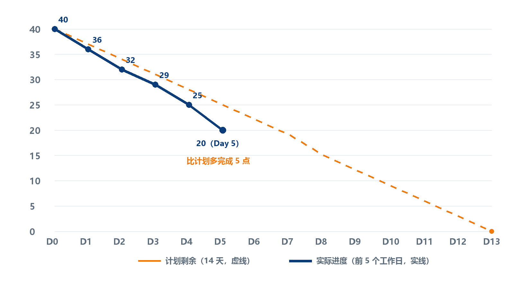

# 门诊排队｜Alpha 冲刺燃尽表（14 天版）

- 总故事点：**40**
- 统计口径：按任务预估点数累计，不是工时
- 对应周期：**Day 0–13，共 14 天**
- 图例：**虚线 = 14 天计划线；实线 = 前 5 个工作日（Day 1–5）实际进度**
- 实际进度只统计到 **Day 5**；Day 6–13 留空，不代表项目结束

---

## 一、燃尽数据

| 节点 | 计划剩余 | 实际剩余 | 当日完成 |
|---|---:|---:|---:|
| Day 0 | 40 | 40 | — |
| Day 1 | 37 | 36 | 4 |
| Day 2 | 34 | 32 | 4 |
| Day 3 | 31 | 29 | 3 |
| Day 4 | 28 | 25 | 4 |
| Day 5 | 25 | 20 | 5 |
| Day 6 | 22 | — | — |
| Day 7 | 19 | — | — |
| Day 8 | 15 | — | — |
| Day 9 | 12 | — | — |
| Day 10 | 9 | — | — |
| Day 11 | 6 | — | — |
| Day 12 | 3 | — | — |
| Day 13 | 0 | — | — |

原始数据：[`燃尽表.csv`](燃尽表.csv)

---

## 二、任务点数拆分（40 点，14 天口径）

| 任务 | 点数 | 计划完成 |
|---|---:|---|
| 报告精简、居中、双侧模拟 | 6 | Day 1 |
| 历史记录列表/详情/删除/恢复 | 4 | Day 2–3 |
| 医院推荐、位置解析与保存 | 8 | Day 2 |
| 10 家医院挂号资料 + 复制 | 5 | Day 3 |
| 医院服务页 | 4 | Day 3 |
| 挂号指引页 | 3 | Day 3 |
| 院内导航（路线/标签/门洞/6 家） | 6 | Day 3–4 |
| 自动重连 / CORS / PNA | 2 | Day 4 |
| 删除假数据、65 项测试、联调、打包 | 5 | Day 4 |
| **合计** | **40** | |

> 注：任务点数是 14 天周期的总预估；前 5 个工作日集中冲刺完成其中一部分，Day 6–13 继续验证与交付，不再单独估点。

---

## 三、怎么读这张图

1. **横轴是 14 天（Day 0–13）**  
   虚线把 40 点摊到整个 Alpha 周期，是计划线。

2. **实线只画前 5 个工作日（Day 1–5）**  
   实线始终位于虚线下方，表示实际剩余每天低于计划；Day 5 实际剩余 20 点，比计划线少 5 点；并且从 Day 1 起，每天的实际剩余都低于计划线。

3. **不是“五天做完”**  
   实线到 Day 5 结束，是因为目前只记录到第五个工作日；Day 6–13 仍有 20 点的工作，只是留空，不虚构实际进度。

4. **前五天每天都在计划线下方**  
   从 Day 1 起，每天的实际剩余都低于计划线；Day 5 剩 20 点，比计划的 25 点多完成 5 点。

---

## 四、边界说明

- 40 点是团队按任务复杂度估的努力量，不是工时；
- 实际剩余只统计到 Day 5，Day 6–13 留空，不虚构未发生的进度；
- 燃尽图不单独作为贡献证据；贡献仍以代码、文档、测试、截图为准。

