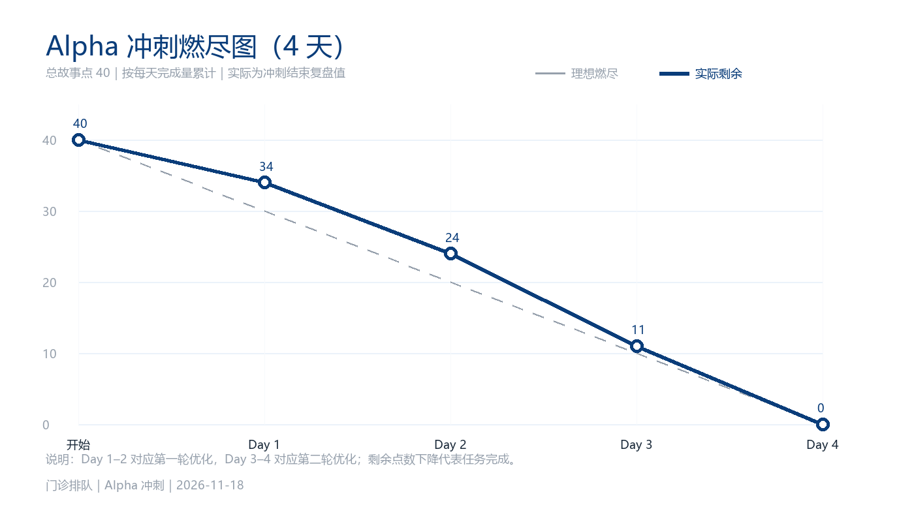

# 门诊排队｜Alpha 冲刺燃尽表

- 总故事点：**40**
- 统计口径：按任务预估点数累计，不是工时
- 数据性质：冲刺结束后的复盘值
- 对应周期：Day 1–4

---

## 一、燃尽数据

| 节点 | 理想剩余 | 实际剩余 | 当日完成 |
|---|---:|---:|---:|
| 开始 | 40 | 40 | — |
| Day 1 | 30 | 34 | 6 |
| Day 2 | 20 | 24 | 10 |
| Day 3 | 10 | 11 | 13 |
| Day 4 | 0 | 0 | 11 |

原始数据：[`燃尽表.csv`](燃尽表.csv)

---

## 二、任务点数拆分

| 任务 | 点数 | 完成时间 |
|---|---:|---|
| 报告精简、居中、双侧模拟 | 6 | Day 1 |
| 历史记录列表/详情/删除/恢复 | 4 | Day 2–3 |
| 医院推荐、位置解析与保存 | 8 | Day 2 |
| 10 家医院挂号资料 + 复制 | 5 | Day 3 |
| 医院服务页 | 4 | Day 3 |
| 挂号指引页 | 3 | Day 3 |
| 院内导航（路线/标签/门洞/6 家） | 6 | Day 3–4 |
| 自动重连 / CORS / PNA | 2 | Day 4 |
| 删除假数据、65 项测试、联调、打包 | 5 | Day 4 |
| **合计** | **40** |  |

---

## 三、怎么读这张图

1. **Day 1–2 实际剩余高于理想线**  
   说明前两天进度慢于计划，主要原因是医院/挂号数据整理和联调比预估耗时。

2. **Day 3–4 实际线快速下降**  
   服务页、挂号指引、导航和连接问题集中收口，最后回到 0。

3. **不粉饰**  
   这是一次“前慢后赶”的冲刺，不是完美按计划执行；燃尽图反映真实节奏。

4. **点数是估算**  
   40 点是团队按任务复杂度估的努力量，不是工时，也不能单独作为贡献证据；贡献仍以代码、文档、测试、截图为准。

---

## 四、燃尽图暴露的问题

- 前两天把“数据整理”低估了：10 家医院挂号信息、6 家导航数据都不是纯代码工作；
- 联调启动偏晚：Day 3 才真正把医院服务页和导航连起来；
- 最后一天压力大：自动重连、CORS、测试、打包都压在 Day 4；
- 结论：下次应把“数据/联调”提前到 Day 1–2，把“加功能”往后放。

---

## 五、证据索引

- 冲刺计划：[`02_Alpha冲刺计划.md`](02_Alpha冲刺计划.md)
- 冲刺总结：[`04_Alpha冲刺总结.md`](04_Alpha冲刺总结.md)
- 联调报告：[`01_联调测试报告.md`](01_联调测试报告.md)
- 测试结果：[`联调测试结果.json`](联调测试结果.json)
