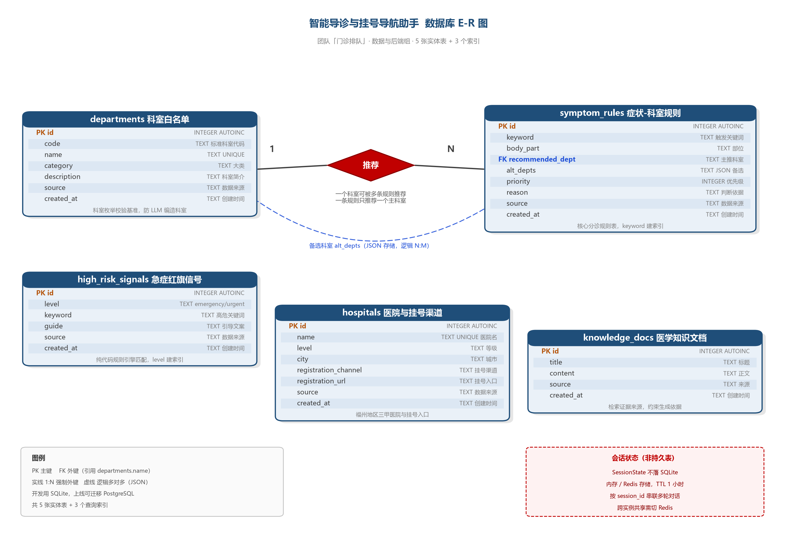

# 门诊排队_数据库设计说明书

> 项目：智能导诊与挂号导航助手 ｜ 团队：门诊排队 ｜ 版本：v1.1（2026-11）
> 本节对应后端工程 `medical-triage-backend`，数据库定义见 `app/knowledge/schema.sql`。
> 开发期使用 SQLite，全部建表语句采用 SQL 标准语法，上线可平移到 PostgreSQL。

## 一、E-R 图



**图 1　智能导诊与挂号导航助手数据库 E-R 图**

### 1.1 实体说明

| 实体 | 表名 | 作用 | 数据来源 |
|---|---|---|---|
| 科室白名单 | `departments` | 保存标准科室名，作为大模型输出科室的枚举校验基准 | 《医疗卫生机构业务科室分类与代码》CT08.00.00.0002 |
| 症状-科室规则 | `symptom_rules` | 核心分诊知识，每条规则把一个触发关键词映射到主推科室与备选科室 | CMeKG 中文医疗知识图谱、中文患者主诉-专科数据集、公开疾病图谱（QASystemOnMedicalKG，统计关联） |
| 急症红旗信号 | `high_risk_signals` | 急症拦截词库，按 I 级 / II 级保存高危关键词与引导文案 | 《急诊预检分诊》WS/T 591—2018 |
| 医院与挂号渠道 | `hospitals` | 福州地区三甲医院及其挂号入口 | 医院官网、官方公众号、114 预约挂号平台 |
| 医学知识文档 | `knowledge_docs` | 检索证据语料，约束大模型"判断依据"只能取材于此 | 公开导诊资料，逐条标注来源 |

### 1.2 联系说明

图中只有一条强制联系：

**科室 —1—〈推荐〉—N— 症状-科室规则**

一条规则只推荐一个主科室，一个科室可被多条规则推荐，因此是 1:N 联系，通过 `symptom_rules.recommended_dept` 外键实现。

`alt_depts`（备选科室）在语义上是"一条规则可对应多个科室"的多值联系，但实现上没有拆成关联表，而是以 JSON 数组字符串存在同一字段中，因此图中用**虚线**标注为逻辑 N:M，详见 2.3 节的范式取舍说明。

`high_risk_signals`、`hospitals`、`knowledge_docs` 三张表独立使用，不参与实体间联系。

### 1.3 不在数据库中的会话状态

多轮对话的会话状态（已收集的症状字段、追问轮数、是否已拦截、历史记录）**不落库**，由内存字典或 Redis 保存，以 `session_id` 为键、TTL 1 小时。图中以红色虚线框单独标出。这样设计的原因是会话数据生命周期只有一次问诊时长，写数据库既增加 I/O 又需要额外的过期清理机制；而切换到 Redis 后可支持多实例共享会话，满足上线部署需求。

---

## 二、关系数据模型

### 2.1 关系模式

将 E-R 图转换为关系模式，主键以下划线语义标注（此处用 `PK` / `FK` 表明）：

```
departments      (id PK, code, name, category, description, source, created_at)
symptom_rules    (id PK, keyword, body_part, recommended_dept FK, alt_depts,
                  priority, reason, source, created_at)
high_risk_signals(id PK, level, keyword, guide, source, created_at)
hospitals        (id PK, name, level, city, registration_channel,
                  registration_url, source, created_at)
knowledge_docs   (id PK, title, content, source, created_at)
```

### 2.2 属性与约束

| 表 | 主键 | 其他约束 | 说明 |
|---|---|---|---|
| `departments` | `id` | `name` UNIQUE NOT NULL | `name` 同时是候选键，被 `symptom_rules` 外键引用 |
| `symptom_rules` | `id` | `keyword` NOT NULL、`recommended_dept` NOT NULL、`priority` 默认 50 | `recommended_dept` 外键指向 `departments.name` |
| `high_risk_signals` | `id` | `level` NOT NULL | `level` 取值限定为 `emergency`（I 级）或 `urgent`（II 级） |
| `hospitals` | `id` | `name` UNIQUE NOT NULL | 医院名唯一，避免重复登记 |
| `knowledge_docs` | `id` | `content` NOT NULL | `source` 记录每条资料的出处 |

**完整性约束分三类：**

- **实体完整性**：五张表均以自增 `id` 为主键，非空且唯一；`departments.name`、`hospitals.name` 上加 UNIQUE，保证业务实体的唯一性。
- **参照完整性**：`symptom_rules.recommended_dept` 通过 `FOREIGN KEY ... REFERENCES departments(name)` 引用科室白名单。这里**刻意引用唯一键 `name` 而非主键 `id`**：规则表由人工维护、以 JSON 形式存储，直接存科室名可读性更好，排查数据问题时不必再关联查询；代价是科室改名必须级联更新，且该列必须存在唯一索引（SQLite 借 `name UNIQUE` 满足，迁移 MySQL 时同样需要先建唯一索引才能建外键）。
- **用户定义完整性**：`high_risk_signals.level` 只允许两个枚举值；`alt_depts` 必须能通过 JSON 解析；`priority` 需为整数，匹配时取最大值。

### 2.3 函数依赖与范式分析

以 `symptom_rules` 为例，其函数依赖为 `id → 其余全部属性`，`priority` 不决定任何其他非主属性，不存在传递依赖，因此满足第三范式——**除一个字段之外**。

`alt_depts` 以 JSON 数组字符串保存多个科室名，属性值不是原子值，严格意义上**违反第一范式**。这是有意的反范式设计，理由有三：

1. 备选科室数量少（0～3 个），且只用于结果展示，不需要单独检索或聚合；
2. 若严格规范化，需再建一张 `symptom_rule_alt_dept` 关联表，查询时多一次 JOIN，而课程项目中该字段的写入频率远低于读取频率，收益不划算；
3. 规则库以 JSON 文件为编辑源，数组结构天然贴合编辑习惯，便于团队成员直接修改。

如果后续需要按备选科室做统计（例如"哪些科室最常作为备选"），则应拆表恢复范式：

```
symptom_rule_alt_dept (rule_id FK, dept_name FK, 主键(rule_id, dept_name))
```

其余四张表均满足第三范式。`departments` 中 `category` 与 `description` 均直接依赖 `id`，`category` 不决定 `description`，无传递依赖。

### 2.4 对象关系映射（实体类与库表的映射）

#### 2.4.1 技术选型说明

后端采用 **Pydantic v2 + 标准库 sqlite3**，未引入 SQLAlchemy 等 ORM 框架，理由：

1. 数据访问模式简单且单向：五张知识表**启动时一次性灌种、运行期只读**；唯一读写路径是 `loader.py` 的"数据库优先、JSON 兜底"查询，SQL 总数不超过 10 条；
2. 引入 ORM 需要额外维护模型-表映射、迁移工具与连接池，对课程项目收益小于成本；Pydantic 已承担数据结构定义与校验职责（即本项目中"实体类"的实际形态）；
3. 保持"知识 JSON 为唯一编辑源、SQLite 为运行载体"的双轨制，成员修改规则直接编辑 JSON，无需理解 ORM 机制。

因此本项目语境下的"对象关系映射"指：**实体类（Pydantic 模型/数据类）与库表、存储之间的完整映射关系**，见下表。

#### 2.4.2 映射总表

| 实体类（定义位置） | 对应库表 / 存储 | 映射关系 | 生命周期 |
|---|---|---|---|
| `SymptomInfo`（app/schemas/models.py） | 内存会话对象；字段语义关联 `symptom_rules.body_part` 等列 | **非持久化**。信息抽取模块的输出；规则匹配时由 `loader.load_departments()` 从 `symptom_rules` 逐行映射出规则对象后间接关联 | 随会话存续，会话结束销毁 |
| `SessionState`（app/schemas/models.py） | `MemorySessionStore`：进程内字典；`RedisSessionStore`：`triage:session:{session_id}` 键，JSON 序列化 | **非表存储**。`session_id → model_dump() JSON` 的 KV 映射；`collected` 为嵌套 `SymptomInfo` | TTL 3600 秒，过期或结束清除 |
| `ChatRequest`（app/schemas/models.py） | 无库表 | HTTP 请求体（`POST /api/v1/chat`），Pydantic 校验：`session_id`/`message` 非空白、`message` 1~4000 字符 | 单次请求 |
| `ChatResponse`（app/schemas/models.py） | 无库表 | HTTP 响应体；`type` ∈ question / result / urgent，`data` 承载结构化字段 | 单次响应 |
| `TriageResult`（app/schemas/models.py） | **不落库**；仅存在于 `SessionState.history` 的 assistant 消息与响应体 | 结构化导诊报告（主推/备选科室、依据、挂号指引、导航、话术、提醒、免责声明）；`recommended_department` 受 `departments` 白名单枚举约束 | 随会话存续，会话销毁即消失 |
| `RetrievedDoc`（app/schemas/models.py） | 读取自 `knowledge_docs` 表（无库时回退 `medical_docs/` 文本切片） | `content→text`、`source→source`、相似度→`score`；向量检索取 top 5 作为生成证据 | 单次检索 |
| `HealthResponse` / `SessionResponse`（app/schemas/models.py） | 无库表 | `GET /api/v1/health`、`GET /api/v1/session/{id}` 响应体 | 单次响应 |

#### 2.4.3 库表到运行期对象的关键映射

- **规则对象**：`loader.load_departments()` 把 `symptom_rules` 逐行映射为规则对象——`keyword→symptom_keywords`、`body_part→body_part`、`recommended_dept→recommended_dept`、`alt_depts`（JSON 字符串）→列表、`priority→priority`、`reason→reason`，供 `RuleRetriever` 关键词匹配；
- **科室白名单**：`departments.name` 聚合为枚举集合，注入 `LLMGateway` 的提示词与返回校验，实现"库表约束大模型输出"的防幻觉闭环；
- **红旗信号**：`high_risk_signals` 按 `level` 分组映射为 `{emergency:{label,guide,keywords}, urgent:{...}}`，供 `TriageInterceptor` 纯代码匹配（不经过大模型）。

---

## 三、数据存储与管理方式

### 3.1 数据库选型

| 阶段 | 方案 | 理由 |
|---|---|---|
| 开发与课程演示 | SQLite 单文件（`data/triage.db`） | Python 标准库 `sqlite3` 直接支持，零安装、零运维；单文件可随代码一起分发，启动即用 |
| 上线部署 | PostgreSQL / MySQL | 建表语句全部采用 SQL 标准语法，`schema.sql` 只需调整自增写法与时间函数即可平移；关系型数据库支持并发写入与事务，适合多用户同时问诊 |

选 SQLite 的边界也很清楚：它采用**数据库级写锁**，同一时刻只允许一个写入者，不适合高并发写入场景。本项目的知识表是只读的（启动时灌一次种子数据），会话状态又不落库，因此写压力几乎为零，SQLite 完全够用；一旦接入真实用户量，直接切 PostgreSQL。

### 3.2 表结构初始化

`app/knowledge/schema.sql` 集中定义全部 DDL，所有建表语句使用 `CREATE TABLE IF NOT EXISTS`，保证**幂等**：重复执行不会报错也不会丢数据。连接建立时执行 `PRAGMA foreign_keys = ON` 显式开启外键约束（SQLite 默认关闭，这一点容易踩坑）。

应用启动时调用 `init_db()`：若 `data/triage.db` 已存在则直接跳过，否则执行建表脚本并自动灌入种子数据，无需任何手工操作。

### 3.3 种子数据管理

`app/db/seed.py` 负责初始化数据，直接从 `app/knowledge/*.json`（唯一编辑源）读取灌入，每张表灌入前先检查是否已有行，避免重复插入。当前数据量（v1.1 整合版）：

| 表 | 行数 | 说明 |
|---|---|---|
| `departments` | 32 | 24 个主推科室 + 8 个备选科室，覆盖内科、外科、五官皮肤、妇儿、急诊等大类 |
| `symptom_rules` | 1775 | 425 条规则展开的关键词行；来源：人工整理 392、CMeKG/主诉数据集第二批扩充 1005、公开疾病图谱统计关联 378（priority=40，低于人工规则） |
| `high_risk_signals` | 417 | I 级（emergency）201 条、II 级（urgent）216 条 |
| `hospitals` | 3 | 协和医院、附一医院、省立医院 |
| `knowledge_docs` | 20 | 按段落切分，供检索作为生成依据 |

后续团队从官方数据源补充数据时，只需往对应表 `INSERT` 新行，业务代码无需改动，实现知识与代码解耦。

`departments` 的 `category` 按大类映射，当前分布为内科 11、其他 8、外科 5、五官皮肤 4、妇儿 2、全科 1、急诊 1。"其他"类偏多源于图谱扩充引入的专科科室，待按标准科室目录（CT08.00.00.0002）补全 code 与 category 映射。

### 3.4 索引设计

```
idx_symptom_rules_keyword     ON symptom_rules(keyword)
idx_high_risk_level           ON high_risk_signals(level)
idx_departments_category      ON departments(category)
```

- `symptom_rules.keyword`：分诊时需按关键词逐条匹配，是最高频的读路径；
- `high_risk_signals.level`：急症拦截按级别优先判断（先查 emergency 再查 urgent），分级过滤是固定操作；
- `departments.category`：按大类浏览与校验科室归属。

`recommended_dept` 上的外键本身依赖 `departments.name` 的唯一索引，不再重复建索引。

### 3.5 双数据源加载策略

`app/knowledge/loader.py` 实现了"数据库优先、JSON 兜底"的加载方式：数据库文件存在则从表中读取，不存在则回退读取 `app/knowledge/*.json`。

这样做的好处是开发期可以脱离数据库直接跑单元测试，降低环境依赖。为消除两份数据不一致的风险，当前约定：**JSON 为唯一编辑源**——规则/红旗词更新后删除 `data/triage.db` 重启即自动重灌；`scripts/reseed.py` 可强制清表重灌，`scripts/import_*.py` 支持增量导入（按关键词幂等去重）。v1.1 已将三份来源的规则与红旗词全部合并进唯一 JSON 源。

### 3.6 会话数据与任务结果管理

会话状态结构与知识表完全分离：

- **内存模式**（默认）：进程内字典加线程锁，单机演示足够，重启即丢失；
- **Redis 模式**（`SESSION_STORE=redis`）：以 `triage:session:{session_id}` 为键写入 JSON，设置 3600 秒过期，支持多实例共享与自动清理。

两种模式通过 `SessionStore` 抽象类统一接口，切换只改 `.env` 中一个配置项，业务代码无需改动，体现"存储与逻辑解耦"。

**任务执行结果（`TriageResult`）不落库**：它以 assistant 消息的形式追加在 `SessionState.history` 中，随会话状态存于内存/Redis，用于前端刷新恢复对话展示；会话结束（用户离开、TTL 过期）即整体销毁，服务器不保留任何问诊内容，与"会话结束数据即刻销毁"的隐私设计一致。若后续增加学习记录/分析记录功能，再新增会话归档表（如 `consult_records`），当前版本按需求范围不保留任务结果。

### 3.7 数据来源与合规

所有知识数据在 `source` 字段标注出处：科室名来自《医疗卫生机构业务科室分类与代码》CT08.00.00.0002；症状规则来自 CMeKG 中文医疗知识图谱、中文患者主诉-专科数据集及公开疾病图谱（QASystemOnMedicalKG，统计关联、priority=40，规则中保留支持数与占比供审核）；急症分级来自《急诊预检分诊》WS/T 591—2018；挂号信息来自医院官方渠道与 114 平台。

系统不做诊断、不开处方，检索内容仅用于生成科室建议与就医指引，每一条结果强制附带"仅供参考，不替代医生诊断"的免责声明。

---

**本节小结**：数据库共 5 张实体表、3 个索引，以科室白名单为枚举基准、症状规则为核心知识、高危信号为安全边界；实体类与库表映射清晰（知识表只读映射、会话与任务结果走缓存不落库），采用"知识表落库 + 会话状态走缓存"的混合存储策略，兼顾了只读知识的高效检索与多轮对话的低延迟写入，以及医疗场景下的隐私合规要求。
